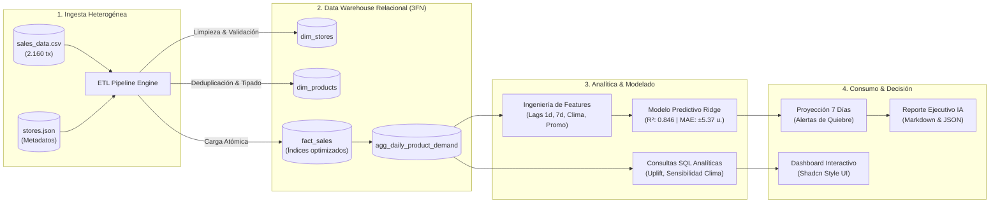
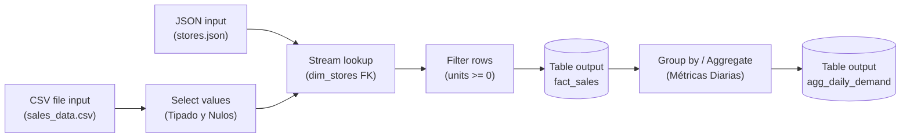

# 📊 Retail Sales & Demand Analytics Pipeline
> **Pipeline End-to-End de Ingeniería de Datos, Modelado Predictivo de Demanda (Machine Learning) y Diagnósticos Automatizados para Retail y Consumo Masivo.**

[](https://python.org)
[](https://sqlite.org)
[-amber)](https://scikit-learn.org)
[](https://docker.com)
[](https://docs.pytest.org)
[](https://juancovili.com)

---

## 🎯 Problema de Negocio y Propósito

En industrias de consumo masivo y distribución de bebidas (FMCG), la demanda de productos clave está fuertemente correlacionada con:
1. **Factores climáticos:** Incremento de temperatura ambiente estacional.
2. **Estacionalidad y calendario:** Peaks de ventas en fines de semana.
3. **Estrategia comercial:** Uplift de volumen impulsado por promociones de precio.

Este proyecto implementa una **solución de datos completa**: desde la ingesta cruda de múltiples fuentes heterogéneas, validación estricta y modelado relacional en SQL, hasta el entrenamiento de un modelo predictivo multivariable y la generación automatizada de reportes ejecutivos para logística y operaciones.

---

## 🏛️ Arquitectura del Pipeline



---

## 📂 Estructura del Repositorio

```text
retail-sales-etl-pipeline/
├── data/
│   ├── raw/                      # Fuentes crudas (CSV y JSON)
│   │   ├── sales_data.csv        # 2.160 transacciones históricas
│   │   └── stores.json           # Dimensiones de tiendas y regiones
│   └── processed/                # Salida consolidada
│       ├── retail_dw.db          # Base de datos relacional SQLite
│       ├── executive_report.md   # Reporte ejecutivo autogenerado
│       └── executive_report.json # Métricas estructuradas en JSON
├── sql/
│   ├── schema.sql                # DDL del Data Warehouse (3FN, FKs, Índices)
│   └── analytical_queries.sql    # 5 consultas avanzadas de negocio
├── src/
│   ├── config.py                 # Rutas y constantes centralizadas
│   ├── etl/
│   │   └── pipeline.py           # Extracción, transformación y carga (ETL)
│   ├── ml/
│   │   └── forecaster.py         # Modelo de predicción Ridge multivariable
│   └── ai/
│       └── reporter.py           # Generador de diagnósticos y alertas operativas
├── static/
│   └── index.html                # Dashboard moderno (Tailwind CDN + Chart.js)
├── tests/
│   ├── test_etl.py               # Tests unitarios del pipeline y constraints
│   └── test_forecast.py          # Tests del modelo ML y KPIs
├── Dockerfile                    # Contenedorización reproducible
├── docker-compose.yml            # Orquestación de pipeline y dashboard
├── requirements.txt              # Dependencias
├── main.py                       # Entrypoint CLI end-to-end
└── README.md                     # Documentación técnica completa
```

---

## ⚙️ Tecnologías y Fundamentos de Ingeniería

1. **Pipeline ETL Robusto (`src/etl/pipeline.py`):**
   * Validación estricta de tipos de datos, descarte de registros nulos o corruptos.
   * Separación dimensional en tercera forma normal (`dim_stores`, `dim_products`, `fact_sales`).
   * Creación automatizada de índices analíticos (`idx_sales_date`, `idx_sales_product`, `idx_sales_store`) para consultas de alta velocidad.
   * Generación de agregaciones temporales (`agg_daily_product_demand`) para desacoplar el consumo de ML de la tabla de hechos cruda.

2. **Modelo Predictivo de Demanda (`src/ml/forecaster.py`):**
   * **Ingeniería de Características:** Lags temporales ($t-1$ y $t-7$), día de la semana, indicador de fin de semana, temperatura ambiente proyectada y flag de campaña promocional.
   * **Algoritmo:** Regresión Ridge Multivariable resuelta de forma analítica cerrada:
     $$\mathbf{w} = (\mathbf{X}^T \mathbf{X} + \lambda \mathbf{I})^{-1} \mathbf{X}^T \mathbf{y}$$
   * **Métricas Obtenidas en Test Set (Holdout 20%):**
     * **$R^2$ (Coeficiente de Determinación):** `0.846` (84.6% de la varianza explicada).
     * **MAE (Error Absoluto Medio):** `±5.37 unidades`.
     * **RMSE:** `7.02`.

3. **Inteligencia Operativa & Alertas (`src/ai/reporter.py`):**
   * Sintetiza las consultas SQL y el pronóstico de 7 días.
   * Detecta picos de demanda y emite alertas de capacidad logística para reabastecimiento en centros de distribución.
   * Exporta resúmenes ejecutivos en Markdown y JSON listos para integración con APIs de mensajería o LLMs.

---


---

## 🔄 Equivalencia y Mapeo en Pentaho Data Integration (PDI / Kettle)

Para entornos empresariales basados en herramientas ETL visuales como **Pentaho Data Integration (PDI)** o **SQL Server Integration Services (SSIS)**, la lógica modular de este pipeline se mapea de forma directa 1:1 en una transformación `.ktr`:



- **Extract:** Steps `CSV file input` y `JSON input` para ingesta paralela de fuentes transaccionales y maestras.
- **Transform:** Steps de `Select values` (conversión explícita de tipos de datos), `Filter rows` (eliminación de inconsistencias) y `Stream lookup` (validación de integridad referencial contra dimensiones).
- **Load:** Step `Table output` con inserción por lotes (batch commit) en bases de datos relacionales (PostgreSQL / SQL Server).

---

## 🚀 Guía de Inicio Rápido

### Opción A: Ejecución Local en 1 Minuto (Sin dependencias externas)

Este proyecto está diseñado con arquitectura **Zero-Friction**: utiliza la librería estándar de Python 3 para que cualquier evaluador pueda ejecutarlo al clonar sin librerías adicionales:

```bash
# 1. Clonar el repositorio
git clone https://github.com/juanCovili/retail-sales-etl-pipeline.git
cd retail-sales-etl-pipeline

# 2. Ejecutar la suite de pruebas automatizadas (7 tests unitarios)
python3 -m unittest discover tests

# 3. Ejecutar el pipeline completo (ETL + SQL + ML + Reporte)
python3 main.py
```

### Opción B: Ejecución con Docker

```bash
# Construir y levantar con Docker Compose
docker compose up --build
```
El pipeline se ejecutará en el contenedor y el dashboard interactivo quedará disponible en `http://localhost:8080`.

---

## 🧪 Pruebas Unitarias Automatizadas

La suite en `tests/` valida automáticamente la integridad del sistema:
- `test_pipeline_execution_status`: Integridad de la ingesta y volumetría.
- `test_database_tables_exist`: Creación correcta de esquemas y DDL.
- `test_foreign_key_integrity`: Ausencia de transacciones huérfanas.
- `test_non_negative_constraints`: Restricciones de integridad de dominio ($units \ge 0, revenue \ge 0$).
- `test_forecast_generation`: Validación de horizonte de 7 días y rango de métricas $0 \le R^2 \le 1$.
- `test_reporter_kpis`: Consistencia de agregaciones comerciales.

```bash
$ python3 -m unittest discover tests
.......
----------------------------------------------------------------------
Ran 7 tests in 0.056s

OK
```

---

## 👨‍💻 Autor

**Juan Andrés Covili Cabezas**  
*Ingeniero en Informática y Analista Programador (INACAP)*  
*Promedio 6.0 · Top 8 de Generación*  
🌐 Portafolio: [juancovili.com](https://juancovili.com)  
💼 LinkedIn: [linkedin.com/in/juan-covili-02b2a114b](https://www.linkedin.com/in/juan-covili-02b2a114b)
